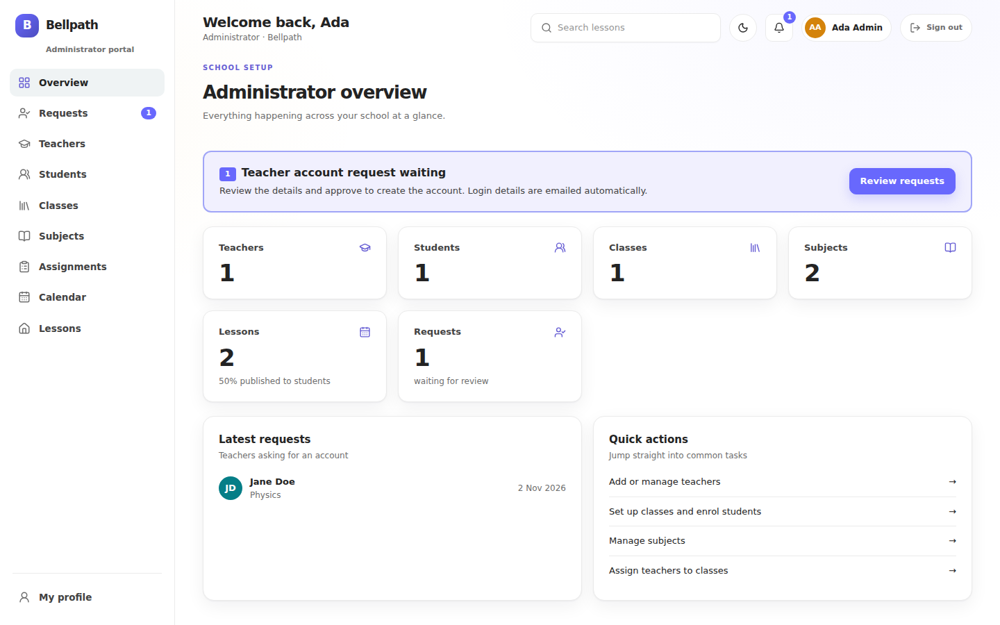

# Bellpath Web

Next.js frontend for Bellpath, a school lesson-planning app. One app serves three role-specific portals on normal paths, with a glass-style UI that supports light and dark mode.

| Portal | Dev URL | Purpose |
|---|---|---|
| Admin | `http://localhost:3000/admin` | Set up subjects, classes, teachers and assignments |
| Teachers | `http://localhost:3000/teachers` | Plan lessons, manage students and enrolment |
| Students | `http://localhost:3000/students` | View published lessons |

## Stack

- Next.js 16 (App Router) and React
- TypeScript
- Tailwind CSS v4
- `next-themes` for light and dark mode
- `lucide-react` for icons

## Project structure

```
web/
  proxy.ts                          Portal authentication and role checks
  .env.local                        API_BASE_URL
  app/
    layout.tsx                      Font, ThemeProvider
    globals.css                     Theme tokens, glass utility
    page.tsx                        Bare-domain landing page
    teachers/(portal)/layout.tsx    App shell for the teachers portal
    teachers/(portal)/page.tsx      Calendar
    students/(portal)/...           Same shape, read-only
    admin/(portal)/...              Same shell, admin screens
  components/
    app-shell.tsx                   Header, side nav, theme toggle
    theme-toggle.tsx
    planner.tsx                     Month calendar and schedule panel
  lib/
    types.ts                        Lesson type, mirrors the API schema
    dates.ts                        Month grid, formatting, subject colours
    lessons.ts                      Data access (mock for now)
```

## Getting started

You need Node.js 20.9 or newer.

```bash
cd web
npm install
echo "API_BASE_URL=http://127.0.0.1:8000" > .env.local
npm run dev
```

Open one of the portal URLs above. The plain `http://localhost:3000` shows the public landing page.

### Environment

| Variable | Default | Purpose |
|---|---|---|
| `API_BASE_URL` | `http://127.0.0.1:8000` | Internal URL for the FastAPI service. |

## Portal routing

Portal routes use their visible URL paths directly:

```
localhost:3000/admin            ->  app/admin/(portal)/page.tsx
localhost:3000/teachers          ->  app/teachers/(portal)/page.tsx
localhost:3000/students          ->  app/students/(portal)/page.tsx
```

- Portal navigation keeps links under the corresponding role prefix, such as `/admin/classes` or `/teachers/classes`.
- The `(portal)` route group keeps the app shell off each portal's `/login` page, such as `/admin/login`. The group name isn't part of the URL.
- The proxy checks the signed-in role on each portal request and redirects users to the matching portal when needed.
- Authentication cookies are shared across paths on the same host, so the proxy enforces the portal role and the API remains the security boundary.

### Production

Serve the app over HTTPS at your school domain; the same host serves the public site and all three portals.

## Theming

Light and dark mode are driven by CSS variables in `app/globals.css`. Components use token classes such as `bg-panel`, `bg-cell`, `border-line`, `text-fg`, `text-muted` and `bg-accent`, so they adapt automatically and rarely need `dark:` variants.

- The theme defaults to the OS setting. The toggle in the header overrides it.
- To restyle, change the variables in `:root` (light) and `.dark`. `--bg-glow` controls the colour wash behind the glass panels, and the alpha of `--panel` and `--cell` controls how see-through they are.
- The `glass` utility applies the translucent background, border, shadow and blur.

## Calendar and schedule

`components/planner.tsx` renders the month grid and the schedule panel for the selected day.

- The visible month is the `?month=YYYY-MM` search parameter. The server page reads it, fetches that month's lessons, and passes them to `Planner`. The component is keyed by month, so navigating remounts it with fresh state.
- "Today" is computed in the school's timezone (`Africa/Nairobi`, set in `lib/dates.ts`) so server and browser agree.
- Each subject gets a stable colour from `subjectColor` in `lib/dates.ts`.
- Draft lessons appear dimmed with a badge. The API never returns drafts to students.

## Data

`lib/lessons.ts` currently returns sample data from `getLessonsForMonth(year, month)`. When the API is wired in, only the body of that function changes: it will call `GET /lessons?date_from=...&date_to=...` with the signed-in user's token.

`lib/types.ts` mirrors the API's `LessonOut`. The calendar needs `start_time`, `subject_name` and `class_name`, so the backend's lesson model and schemas must include them (see `server/README.md`).

## Adding a page to a portal

1. Create `app/<portal>/(portal)/<route>/page.tsx`.
2. Add a nav item for it in the `NAV` map in `components/app-shell.tsx`, using a path relative to the portal prefix, for example `/classes`.

## Roadmap

- Login page per portal, backed by a Next route handler that calls the API and stores tokens in httpOnly cookies.
- Check that the signed-in role matches the requested portal, and redirect otherwise.
- Token refresh, logout, and the real user name in the header.
- Replace the mock lessons with API calls.
- Lesson create and edit dialog (`POST /lessons`, `PATCH /lessons/{id}`).
- Admin screens for subjects, classes, teachers and assignments.
- Mobile layout, with the side nav becoming a bottom bar on small screens.
- A time-of-day greeting in the header as a small client component.

## Scripts

| Command | Purpose |
|---|---|
| `npm run dev` | Development server |
| `npm run build` | Production build |
| `npm run start` | Serve the production build |
| `npm run lint` | Lint |
